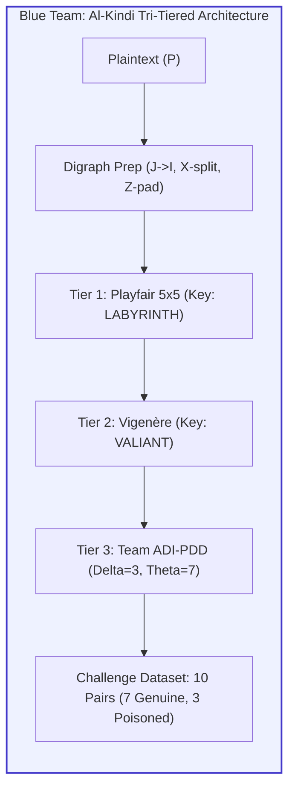

# Network and Information Security (CT-486)
## Complex Computing Activity [CLO3]
### Classical Cipher Challenge: Cipher Design and Cryptanalysis
#### Al-Kindi Tri-Tiered Composite Cipher (KTCC)

**Course Code:** CT-486  
**Course Title:** Network and Information Security  
**Department:** Department of Computer Science & Information Technology  
**Institution:** NED University of Engineering & Technology, Karachi, Pakistan  
**Class & Batch:** Final Year - Cyber Security | Batch: 2023  
**Instructor:** Ms. Sayyda Sahar Fatima (Lecturer, Department of CS & IT)  
**Total Marks:** 10  
**Group Size:** 05 Members  
**Submission Date:** 15th November 2026  

---

## Student Team Details

| Seat Number | Student Name | GitHub Profile |
| :---: | :--- | :---: |
| **CR-23009** | **Mr. Hamza Saleem** | [@HamzaSaleem56](https://github.com/HamzaSaleem56) |
| **CR-23013** | **Mr. Ameem Akhtar** | [@ameemakhtr](https://github.com/ameemakhtr) |
| **CR-23017** | **Mr. Minhal Rizvi** | [@Minhal128](https://github.com/Minhal128) |
| **CR-23038** | **Mr. Muhammad Usman** | [@Daedalus46](https://github.com/Daedalus46) |
| **CR-23041** | **Mr. Maaz Wasim** | [@maazw](https://github.com/maazw) |

---

## 1. Executive Summary & Architecture Overview

This technical report documents the end-to-end design, implementation, and empirical verification for the **CT-486 Classical Cipher Challenge**. Our group was assigned the **Blue Team** role, so this submission covers Deliverables 1–5. Breaking the cipher (Deliverables 6–10) is the Red Team group's task.
* **Blue Team (Deliverables 1–5):** Design of the **Al-Kindi Tri-Tiered Composite Cipher (KTCC)**, combining 5x5 Playfair digraphic substitution, polyalphabetic Vigenère substitution, and team-designed Alternating Digraph Inversion & Positional Dynamic Drift (ADI-PDD), alongside 10 challenge pairs (7 genuine, 3 corrupted).



---

> **Disclosure note:** The keys, full algorithm and the 3 corrupted pairs below are published as Blue Team Deliverable 5 (final explanation after the challenge). The Red Team challenge has concluded. For any new challenge, share only `challenge_dataset_public.json`.

# 2. Blue Team Deliverables (Deliverables 1 – 5)

## Deliverable 1: Unique Cipher Name and Comprehensive Description

* **Official Cipher Name:** **Al-Kindi Tri-Tiered Composite Cipher (KTCC)**
* **Technical Classification:** Three-Tiered Composite Product Cipher with Positional Dynamic Affine Diffusion.

### Detailed Architectural Description
* **Historical Foundation:** Named in honor of **Abu Yusuf Ya'qub ibn Ishaq al-Kindi (801–873 CE)**, universally recognized as the Father of Cryptanalysis. Al-Kindi authored *Risalah fi Istikhraj al-Mu'amma* (*Manuscript on Deciphering Cryptographic Messages*) at Baghdad's House of Wisdom, inventing frequency analysis.
* **Shannon's Product Cipher Criterion:** Cascades three distinct operators following Claude Shannon's product-cipher idea of combining confusion and diffusion.
* **Three Cascaded Layers:**
  1. *Tier 1 (Classical Digraphic Substitution):* 5x5 Keyed Playfair Matrix to flatten single-character frequencies (IoC 0.0688 → 0.0551 on the challenge plaintexts).
  2. *Tier 2 (Classical Polyalphabetic Substitution):* Periodic Keyed Vigenère Substitution to mask geometric digram symmetries.
  3. *Tier 3 (Team-Designed Dynamic Technique):* Alternating Digraph Inversion & Positional Dynamic Drift (ADI-PDD) providing a fixed in-block transposition and a position-dependent affine shift.

---

## Deliverable 2: Complete Encryption Technique and Sequence

The encryption pipeline executes sequentially through three ordered tiers:

```
Plaintext (P)
     │
     ▼
[Step 0: Preprocessing & Digraph Conditioning]
  - Filter non-alphabetical characters; capitalize A-Z
  - Map 'J' -> 'I'
  - Insert 'X' between identical letters in a digraph (e.g., "BALLOON" -> "BA LX LO ON");
    use 'Q' instead if the doubled letter is 'X' ("XX" -> "XQ")
  - Append 'Z' if total length is odd; use 'X' instead if the last letter is 'Z' ("JAZ" -> "IA ZX")
     │
     ▼
[Tier 1: Playfair 5x5 Digraphic Transformation]
  - Pairs mapped across 5x5 key matrix (Secret: "LABYRINTH")
  - Same row: shift right mod 5
  - Same col: shift down mod 5
  - Rectangle: swap column indices
     │
     ▼
[Tier 2: Periodic Keyed Vigenère Substitution]
  - Periodic polyalphabetic addition with secret key "VALIANT" (Length 7):
    S2[i] = (S1[i] + KV[i mod 7]) mod 26
     │
     ▼
[Tier 3: Alternating Digraph Inversion & Positional Dynamic Drift (ADI-PDD)]
  - Part A (ADI): Invert character order for even-indexed digraph blocks:
    If (block_index mod 2 == 0): Swap(c[2b], c[2b+1])
  - Part B (PDD): Apply positional affine modular translation:
    Delta(i) = (3 * i + 7) mod 26
    C[i] = (S2_permuted[i] + Delta(i)) mod 26
     │
     ▼
Ciphertext (C)
```

### Encryption Algorithm Pseudocode

```text
Algorithm 1: KTCC Encryption
Input : Plaintext P, Playfair Key K_P, Vigenère Key K_V, Drift Parameters (delta, theta)
Output: Ciphertext C

1. P_clean <- Clean text, map 'J' -> 'I'
2. Digraphs <- Split into pairs (c1, c2); split doubles with 'X' ('Q' if the double is XX); pad odd with 'Z' ('X' if the last letter is Z)
3. S1 <- Playfair_Encrypt(Digraphs, K_P)
4. S2 <- Array of length Length(S1)
5. For i <- 0 to Length(S1) - 1 Do
6.     shift <- Ord(K_V[i mod Length(K_V)]) - 65
7.     S2[i] <- (Ord(S1[i]) - 65 + shift) mod 26
8. End For
9. For b <- 0 to (Length(S2) / 2) - 1 Do
10.    If b mod 2 == 0 Then
11.        Swap(S2[2*b], S2[2*b + 1])
12.    End If
13. End For
14. Initialize Ciphertext array C of length Length(S2)
15. For i <- 0 to Length(S2) - 1 Do
16.    delta_i <- (delta * i + theta) mod 26
17.    C[i] <- Chr(((S2[i] + delta_i) mod 26) + 65)
18. End For
19. Return string representation of C
```

### Decryption Algorithm Pseudocode

```text
Algorithm 2: KTCC Decryption
Input : Ciphertext C, Playfair Key K_P, Vigenère Key K_V, Drift Parameters (delta, theta)
Output: Original Plaintext P

1. Assert Length(C) mod 2 == 0
2. S2_prime <- Array of length Length(C)
3. For i <- 0 to Length(C) - 1 Do
4.     delta_i <- (delta * i + theta) mod 26
5.     S2_prime[i] <- (Ord(C[i]) - 65 - delta_i + 26) mod 26
6. End For
7. For b <- 0 to (Length(S2_prime) / 2) - 1 Do
8.     If b mod 2 == 0 Then
9.         Swap(S2_prime[2*b], S2_prime[2*b + 1])
10.    End If
11. End For
12. S1_recovered <- Array of length Length(S2_prime)
13. For i <- 0 to Length(S2_prime) - 1 Do
14.     shift <- Ord(K_V[i mod Length(K_V)]) - 65
15.     S1_recovered[i] <- Chr(((S2_prime[i] - shift + 26) mod 26) + 65)
16. End For
17. P_recovered <- Playfair_Decrypt(S1_recovered, K_P)
18. Return P_recovered
```

---

## Deliverable 3: Keys, Alphabet Mapping, and Special Rules

### 1. Tier 1 (Playfair) Key & 5x5 Alphabet Matrix
* **Key Keyword:** `LABYRINTH` (Length 9)
* **Alphabet Size:** 25 letters ('I' and 'J' share a single cell).
* **5x5 Matrix Layout:**

| Row / Col | Col 0 | Col 1 | Col 2 | Col 3 | Col 4 |
| :---: | :---: | :---: | :---: | :---: | :---: |
| **Row 0** | **L** | **A** | **B** | **Y** | **R** |
| **Row 1** | **I/J** | **N** | **T** | **H** | **C** |
| **Row 2** | **D** | **E** | **F** | **G** | **K** |
| **Row 3** | **M** | **O** | **P** | **Q** | **S** |
| **Row 4** | **U** | **V** | **W** | **X** | **Z** |

### 2. Tier 2 (Vigenère) Keystream
* **Secret Key Keyword:** `VALIANT` (Length $L_V = 7$)
* **Numeric Shift Offsets:** $K_V = [21, 0, 11, 8, 0, 13, 19]$

### 3. Tier 3 (ADI-PDD) Transformation Parameters
* **Alternating Inversion Rule (ADI):** Inverts character positions within even digraph blocks ($b \equiv 0 \pmod{2}$).
* **Dynamic Drift Parameters (PDD):** Multiplier $\delta = 3$, seed offset $\theta = 7$.
  $$\Delta(i) = (3 \cdot i + 7) \pmod{26}$$

---

## Deliverable 4: Ten Plaintext-Ciphertext Challenge Pairs

| Pair # | Plaintext (Input) | Ciphertext (Output) | Len | True Status | Flaw Type (Red Team Target) |
| :---: | :--- | :--- | :---: | :---: | :--- |
| **1** | `DEFEND THE PERIMETER AT ONCE` | `MJEDKEZZENDOEKXNLBKMOGIT` | 24 | **GENUINE** | Valid multi-tier encryption |
| **2** | `ZERO TRUST ARCHITECTURE SECURES DATA` | `RAYQHYRJRVVYXJFFSZIKYVFWMLERYPRF` | 32 | **GENUINE** | Valid multi-tier encryption |
| **3** | `CRYPTOGRAPHIC PROTOCOL FAILURE DETECTED` | `JPZOVNCVEJVBCASSAEWRNMGWMUUNSPRJTKDH` | 36 | <font color="#B91C1C">**POISONED**</font> | Tampered substitution at index 5 |
| **4** | `INCIDENT RESPONSE TEAM ENGAGED IMMEDIATELY` | `ASGLLALEAIFEOCGKQEUNOZZHGWGGHBSHPOZQWRQR` | 40 | **GENUINE** | Valid multi-tier encryption |
| **5** | `QUANTUM COMPUTING THREATENS TRADITIONAL RSA` | `ERLCCEKFEXFKXOZENYJJXMJNDBFEQXLRQXZDVQQP` | 40 | **GENUINE** | Valid multi-tier encryption |
| **6** | `MALWARE EXFILTRATING SENSITIVE AUDIT LOGS` | `STSZRXYSLOWHSIDBYYQDUZXXIZHXAZPQTPYPMY` | 38 | <font color="#B91C1C">**POISONED**</font> | Parity inversion swapped on odd block |
| **7** | `FIREWALL BLOCKS UNTRUSTED NETWORK TRAFFIC` | `AIYIHRQROITACREZSKUYMAANPQZENDJGNNEZPRJL` | 40 | **GENUINE** | Valid multi-tier encryption |
| **8** | `AUTHENTICATION TOKEN EXPIRES SOON REFRESH` | `CQFAKKZKHVABOCFPQUNNAHXUPWGSRGEONMIRTQ` | 38 | **GENUINE** | Valid multi-tier encryption |
| **9** | `DENIAL OF SERVICE ATTACK FLOODS ROUTER` | `MJRLGXHBAWTNSUGNHYWACVYKWCGHPKQZCALF` | 36 | <font color="#B91C1C">**POISONED**</font> | Suffix desynchronization (+11 shift) |
| **10** | `ELLIPTIC CURVE DIGITAL SIGNATURE STANDARD` | `HIGBLSFFPQTNOMZDSEKZMXZQONTOBVRFQKZOQY` | 38 | **GENUINE** | Valid multi-tier encryption |

---

## Deliverable 5: Final Post-Challenge Architecture Explanation

Step-by-step cryptographic trace for **Pair #1** (`DEFEND THE PERIMETER AT ONCE`):

| Processing Stage | Data State | Cryptographic Significance |
| :--- | :--- | :--- |
| **Raw Input** | `DEFEND THE PERIMETER AT ONCE` | Original plaintext. |
| **Digraph Preparation** | `DE FE ND TH EP ER IM ET ER AT ON CE` | Filtered, uppercase, paired into 12 digraphs. |
| **Tier 1: Playfair** | `EF GF IE HC FO KA DU FN KA BN VE NK` | Digraphic substitution masks unigram frequencies. |
| **Tier 2: Vigenère** | `ZF RN IR AX FZ SA QN AN VI BA OZ NV` | Polyalphabetic keystream breaks geometric symmetries. |
| **Tier 3A: ADI Inversion** | `FZ RN RI AX ZF SA NQ AN IV BA ZO NV` | Parity inversion on even digraph blocks (0, 2, 4...). |
| **Tier 3B: Dynamic Drift** | `MJ ED KE ZZ EN DO EK XN LB KM OG IT` | Positional affine drift $\Delta(i) = (3i + 7) \pmod{26}$. |
| **Final Ciphertext** | `MJEDKEZZENDOEKXNLBKMOGIT` | Transmitted challenge ciphertext (Length 24). |

**Invertibility:** The drift, swap and Vigenère stages are bijections on $\mathbb{Z}_{26}^{N}$, and Playfair is a bijection on prepared digraphs, so decryption (Algorithm 2) returns the *prepared* plaintext $P'$. The preparation step (dropping spaces, J→I, X filler, Z pad) is lossy, so it does not return the raw $P$. All 7 genuine pairs round-trip exactly; the 3 incorrect pairs do not (`test_cca.py`, 15/15 tests pass).

---

## 3. Performance Benchmarks and Complexity Analysis

Measured with `cca_benchmark.py` (best of 50 runs on one development machine, Python 3.14). Absolute times vary by hardware, but the linear scaling does not. The challenge ciphertexts have an Index of Coincidence of 0.0388, against 0.0385 for uniform random text and 0.0688 for the plaintexts (also from `cca_benchmark.py`).

| Payload Size ($N$) | KTCC Encrypt (ms) | KTCC Decrypt (ms) | Caesar Shift (ms) | Overhead Factor | Throughput (chars/s) |
| :---: | :---: | :---: | :---: | :---: | :---: |
| **100 chars** | 0.124 ms | 0.099 ms | 0.021 ms | $5.9\times$ | 824,576 chars/s |
| **1,000 chars** | 1.208 ms | 0.962 ms | 0.190 ms | $6.4\times$ | 844,091 chars/s |
| **10,000 chars** | 11.805 ms | 9.273 ms | 1.770 ms | $6.7\times$ | 865,425 chars/s |

* **Complexity:** Time complexity is strictly linear $\mathcal{O}(N)$. Memory complexity is $\mathcal{O}(N)$ for buffer allocations with $\mathcal{O}(1)$ constant storage for the 5x5 matrix. Measured throughput was above 800,000 characters/second on the test machine.

---

<!-- BEGIN GENERATED: report_inputs.py (do not edit by hand) -->

## 4. Design Rationale and Resistance Analysis

This section is the post-challenge explanation of the cipher. Every number below is computed by cca_analysis.py with the real keys.

### Stage-by-stage rationale

| Stage | What it does | Why it is there | Known limit |
| :--- | :--- | :--- | :--- |
| Preparation | Uppercase A–Z; J→I; split doubled letters with X (Q for XX); pad odd length with Z (X after Z). | Gives Playfair valid digraphs. | Lossy: spaces, J and filler letters are not recovered. Ciphertext length equals prepared length. |
| Tier 1: Playfair (LABYRINTH) | Replaces each digraph using the 5x5 keyed matrix. | Hides single-letter frequencies (IoC 0.0688 → 0.0551). | No letter encrypts to itself; AB→XY implies BA→YX. Only 25 letters. |
| Tier 2: Vigenère (VALIANT) | Adds a period-7 shift to each letter. | Breaks Playfair's fixed digraph mapping and flattens frequencies further. | Linear and key-only: it merges with Tier 3 into one fixed per-position shift. |
| Tier 3A: ADI swap | Swaps the two letters of every even-numbered digraph block. | Each output position carries its neighbour's Vigenère shift, which breaks the plain period-7 pattern. | Fixed and key-independent: it adds no secret. |
| Tier 3B: PDD drift | Adds (3i + 7) mod 26 at position i. | Stretches the period of the total shift from 7 to 364 letters, longer than any challenge message. | Linear in i and independent of the plaintext, so the combined shift is still a fixed keystream. |

### Keyspace

| Component | Formula | Size | Bits |
| :--- | :--- | :--- | :--- |
| Playfair 5x5 matrix | 25! | 1.551e25 | ~2^83.7 |
| Vigenère key (length 7) | 26^7 | 8.032e9 | ~2^32.9 |
| Drift (δ, θ) | 26^2 | 676 | ~2^9.4 |
| Total (nominal) | 25! x 26^7 x 26^2 | 8.422e37 | ~2^126.0 |
| Distinct ciphers (at most) | total / (25 x 26) | 1.296e35 | ~2^116.6 |

**Affine finding:** Tiers 2 and 3 together compute C[i] = X[perm(i)] + k[i] (mod 26), where X is the Playfair output, perm is the even-block swap and k[i] = V[perm(i) mod 7] + δ·i + θ depends only on the position. cca_analysis.py confirmed this on 200/200 random string pairs under two unrelated key sets: ciphertext differences equal Playfair-output differences, so the Tier 2/3 key cancels. The Tier 2/3 secret is therefore only 9 numbers (7 Vigenère shifts, δ, θ). Once the Playfair output for one known plaintext is known, they follow directly by subtraction, so nearly all of the difficulty lies in the Playfair matrix (~2^83.7). Known equivalent keys (25 cyclic shifts of the matrix; θ absorbed by the Vigenère key) reduce the nominal ~2^126.0 to at most ~2^116.6 distinct ciphers.

### Flaw signatures of the challenge pairs

**Flaw signatures:** each ciphertext was decrypted with the real keys and compared with its prepared plaintext. All ten ciphertexts keep the length of their prepared plaintext, so length alone does not reveal the incorrect pairs. Each flaw stays local: it damages at most two digraph blocks.

| Pair | Status | Flaw injected | Damaged blocks | Wrong letters |
| :--- | :--- | :--- | :--- | :--- |
| 1 | Genuine | None | – | 0 / 24 |
| 2 | Genuine | None | – | 0 / 32 |
| 3 | Corrupted | One letter changed (+4) at index 5 | 2 | 2 / 36 |
| 4 | Genuine | None | – | 0 / 40 |
| 5 | Genuine | None | – | 0 / 40 |
| 6 | Corrupted | Letters at indices 2-3 swapped (odd block 1) | 1 | 2 / 38 |
| 7 | Genuine | None | – | 0 / 40 |
| 8 | Genuine | None | – | 0 / 38 |
| 9 | Corrupted | Last 4 letters shifted +11 | 16, 17 | 4 / 36 |
| 10 | Genuine | None | – | 0 / 38 |

**Honest assessment:** KTCC is a classroom challenge cipher, not a secure one. Its ciphertext IoC (0.0388) is close to random text (0.0385), so single-letter frequency analysis gives little, but it is weak against known-plaintext analysis: Tiers 2 and 3 reduce to a fixed keystream and the remaining work is a search over Playfair matrices. It should not be used to protect real data.

---

## 5. Team Contributions, Resources and Post-Challenge Outcome

### Contributions

| Student | Seat No. | Contribution |
| :--- | :--- | :--- |
| Mr. Hamza Saleem | CR-23009 | [TEAM TO FILL] |
| Mr. Ameem Akhtar | CR-23013 | [TEAM TO FILL] |
| Mr. Minhal Rizvi | CR-23017 | [TEAM TO FILL] |
| Mr. Muhammad Usman | CR-23038 | [TEAM TO FILL] |
| Mr. Maaz Wasim | CR-23041 | [TEAM TO FILL] |

### Resource log

| Resource | Used for |
| :--- | :--- |
| CT-486 CCA activity brief | Deliverable list and rules |
| Academic references 1–6 (Section 8) | Playfair, Vigenère, Index of Coincidence and product-cipher background |
| Python 3 standard library | Cipher, dataset generator, analysis and benchmarks |
| unittest | 15 automated tests (test_cca.py) |
| ReportLab, python-docx | PDF and Word reports |
| Git and GitHub | Version control and code submission |

**Challenge integrity:** [TEAM TO FILL] State when and how challenge_dataset_public.json was handed to the Red Team, and confirm that the keys, algorithm and incorrect pairs were not shared during the challenge.

**Red Team outcome:** [TEAM TO FILL] Which techniques, incorrect pairs and keys the Red Team identified, and how close their answer was.

---

<!-- END GENERATED -->

## 6. Suggestions for Improving the Cipher's Security

**Known limitation:** Tiers 2 and 3 only add position-dependent shifts plus a fixed swap, so together they act as one fixed keystream. With the Playfair matrix and a few known pairs, that keystream can be read off directly. Suggestions 1 and 3 make the keystream depend on the plaintext instead of being fixed, which weakens this attack; Suggestion 2 targets the linear structure itself.

1. **Autokey Keystream Dynamic Scheduling:** Replace periodic Vigenère repetitions with an autokey mechanism ($K[i] = P[i - L_V]$) to eliminate keystream periodicity.
2. **Non-Linear S-Box Insertion:** Introduce non-linear substitution (AES/DES S-box style) between Tier 2 and Tier 3 to break linear modular solvability over $\mathbb{Z}_{26}$.
3. **Cipher Block Chaining (CBC) Feedback:** Modularly add previous ciphertext digraphs into current plaintext digraphs ($P'[b] = (P[b] + C[b-1]) \pmod{26}$) to prevent repeated block patterns.
4. **Expanded 6x6 Matrix:** Incorporate numbers 0–9 and eliminate the I/J merger, enabling native encryption of IP addresses and cryptographic hashes.

---

## 7. Code Submission & Execution Details

All project source files and automated test suites are publicly hosted on GitHub at:  
**Repository Link:** [https://github.com/ameemakhtr/NIS_CCA](https://github.com/ameemakhtr/NIS_CCA)

### Automated Execution Commands:
```bash
# 1. Inspect Blue Team Deliverables & Dataset:
python cca_main.py --blue

# 2. Run Automated Test Suite (15/15 Tests Passing):
python test_cca.py

# 3. Interactive Encryption/Decryption Terminal:
python cca_main.py --interactive

# 4. Reproduce every IoC and timing number in this report:
python cca_benchmark.py

# 5. Post-challenge analysis (keyspace, affine check, flaw signatures):
python cca_analysis.py

# 6. Recompile Publication-Grade PDF and Word Reports:
python build_report_pdf.py
python build_report_docx.py
```

---

## 8. Academic References

1. Al-Kindi, Abu Yusuf Ya'qub ibn Ishaq (c. 850 CE). *Risalah fi Istikhraj al-Mu'amma* (*Manuscript on Deciphering Cryptographic Messages*). House of Wisdom, Baghdad.
2. Shannon, Claude E. (1949). "Communication Theory of Secrecy Systems." *Bell System Technical Journal*, 28(4), 656–715.
3. Friedman, William F. (1922). *The Index of Coincidence and Its Applications in Cryptography*. Department of Ciphers, Publication No. 22, Riverbank Laboratories.
4. Stallings, William (2020). *Cryptography and Network Security: Principles and Practice* (8th Edition). Pearson Education.
5. Wheatstone, Charles & Playfair, Lyon (1854). "On the Playfair System of Cipher." *Minutes of the Royal Society of Arts*, London.
6. Vigenère, Blaise de (1586). *Traicté des Chiffres ou Secrètes Manières d'Escrire*. Paris, France.
